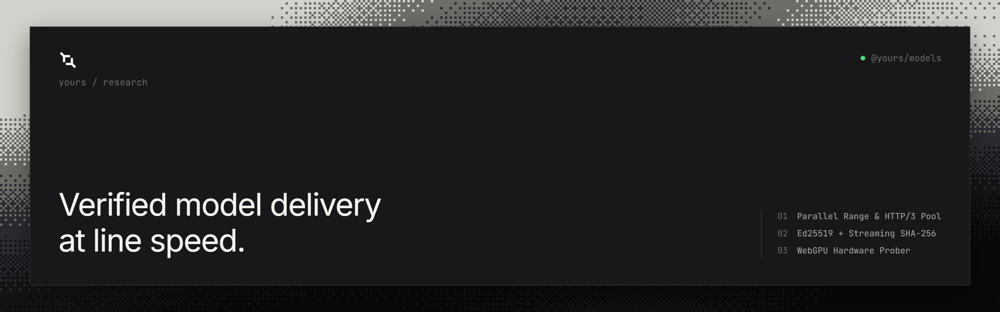
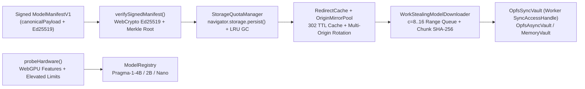

<div align="center">
  <a href="https://yours.sh">
    <picture>
      <source media="(prefers-color-scheme: dark)" srcset="https://raw.githubusercontent.com/yours-research/yours-models/main/assets/hero-dark.png">
      <source media="(prefers-color-scheme: light)" srcset="https://raw.githubusercontent.com/yours-research/yours-models/main/assets/hero-light.png">
      
    </picture>
  </a>
</div>

<p align="center">
  <a href="https://yours.sh">yours.sh</a> ·
  <a href="https://github.com/yours-research">GitHub Org</a> ·
  <a href="https://huggingface.co/yours-research">Hugging Face</a> ·
  <a href="https://x.com/yoursdotsh">X (@yoursdotsh)</a>
</p>

# `@yours/models`

Verified model delivery, WebCrypto **Ed25519** signed manifest verification, resumable work-stealing **OPFS** storage vault, and **WebGPU** hardware prober SDK for Chrome MV3 extensions and `yours.sh` web demos.

Zero runtime dependencies. Pure Web Standards (`crypto.subtle`, `fetch`, OPFS `FileSystemSyncAccessHandle`, WebGPU `navigator.gpu`), strict TypeScript, and Apache-2.0 licensed.

---

## Why `@yours/models` Exists (Empirical Benchmarks)

Shipping multi-GB weights inside a Chrome MV3 extension bundle is infeasible, while naive browser `fetch()` from Hugging Face Xet CAS (`us.aws.cdn.hf.co`) gets throttled by Chromium's single-connection HTTP/2 (`h2`) socket coalescing.

Measured in [`DOWNLOAD_BENCHMARKS.md`](https://github.com/yours-research) on a ~190 Mbps link targeting `2.47 GiB` (`2,651,081,621 B`) pre-repacked WGSL shards:

| Metric / Trial | Baseline | `@yours/models` Architecture | Observed Impact |
| :--- | :--- | :--- | :--- |
| **Transport Throughput** | `1.51–1.53 MiB/s` (`h2` single-conn, ~27.5 min ETA) | **`21.74–22.83 MiB/s`** (`c=8–16` parallel `Range` + work-stealing) | **~14.6× faster** (`110.7–116.3s` for `2.47 GiB`) |
| **Chunk SHA-256 Verification** | Unverified or full-file after download | **`1,857.36 MiB/s`** CPU (`21.56 MiB/s` end-to-end w/ SHA-256 on) | **`<1.2%` overhead**; catches 1-byte flips immediately |
| **Corruption Recovery** | Re-download entire `2.47 GiB` bundle | Re-fetches **only** the failed `8–16 MiB` chunk (`1.51s`) | **Zero wasted bandwidth** |
| **Restart Resume** | Restart from `0 B` or blind byte append | Verifies `128 MiB` on disk in **`98.50 ms`** via `.part` bitmap | **Fast verified resume** |
| **Q4 Weight Compression** | `gzip-6` (`93.92%`, `7.707 bits/byte` entropy) | **Uncompressed pre-repacked WGSL shards** (`2.47 GiB`) | Saves `~30s` WASM repack & `~2.6 GiB` peak disk |
| **Hub `302` Redirects** | `48–94 ms` + `3,000 req / 300s` rate limit | **Pre-resolved CDN URL caching (`50 min` TTL)** | **1 resolver call per file** |

---

## Architecture



---

## Quickstart

### 1. Probe WebGPU Hardware & Recommend a Pragma Model

```ts
import { probeHardware } from '@yours/models';

const probe = await probeHardware();
console.log(probe.profile);
// {
//   hasWebGpu: true,
//   tier: 'tier1-f16-subgroups',
//   adapterVendor: 'nvidia',
//   maxStorageBufferBindingSize: 2147483648,
//   maxBufferSize: 4294967296,
//   estimatedVramGB: 8,
//   recommendedModelId: 'Pragma-1-4B'
// }
```

### 2. Verify Manifest & Download into Dedicated Worker OPFS

```ts
import {
  downloadVerifiedModel,
  OpfsSyncVault,
  type ModelManifestV1,
} from '@yours/models';

const PINNED_PUBLIC_KEY_BASE64 = '<32-byte-ed25519-public-key-base64>';

const vault = new OpfsSyncVault();
const manifest: ModelManifestV1 = await fetch(
  'https://cdn.yours.sh/pragma-1-4b/manifest.v1.signed.json',
).then((r) => r.json());

const result = await downloadVerifiedModel(manifest, {
  vault,
  pinnedPublicKeys: [PINNED_PUBLIC_KEY_BASE64],
  concurrency: 8,
  allowedHosts: ['cdn.yours.sh', 'huggingface.co', '*.cdn.hf.co'],
  onProgress: (t) => {
    console.log(
      `[${t.phase}] ${(t.bytesDownloaded / 1048576).toFixed(1)} MiB @ ${t.speedMiBs.toFixed(1)} MiB/s (ETA ${t.etaSec.toFixed(0)}s)`,
    );
  },
});

console.log('Installed model key:', result.modelKey);
```

### 3. Sign & Build Manifests (Release Tooling)

```ts
import {
  generateEd25519KeyPair,
  signManifest,
  sha256Hex,
} from '@yours/models/manifest';

const { publicKey, privateKey } = await generateEd25519KeyPair();
const signed = await signManifest(
  {
    schemaVersion: 1,
    modelId: 'yours-research/Pragma-1-4B-WGSL',
    version: '1.0.0',
    architecture: 'qwen35-deltanet',
    quantization: 'q4f16',
    totalBytes: slabBytes.byteLength,
    merkleRoot: '', // computed automatically from artifacts/chunks when empty
    artifacts: [
      {
        path: 'slab0.part00.bin',
        sizeBytes: slabBytes.byteLength,
        sha256: await sha256Hex(slabBytes),
        chunkSizeBytes: 16 * 1024 * 1024,
        chunkSha256: [/* ... */],
        urls: [
          'https://cdn-0.yours.sh/pragma-1-4b/slab0.part00.bin',
          'https://cdn-1.yours.sh/pragma-1-4b/slab0.part00.bin',
        ],
      },
    ],
  },
  privateKey,
);
```

---

## API Reference

| Module | Key Exports | Responsibility |
| :--- | :--- | :--- |
| `@yours/models/contracts` | `ModelManifestV1`, `ModelArtifactEntry`, `HardwareProfile`, `WgslComputeTier` | Shared TypeScript interfaces from `ECOSYSTEM_CONTRACTS.md` |
| `@yours/models/manifest` | `canonicalizeJson`, `signManifest`, `verifySignedManifest`, `computeMerkleRoot`, `StreamingSha256`, `RedirectCache`, `OriginMirrorPool` | Deterministic JSON, WebCrypto Ed25519, Merkle proofs, CDN redirect & mirror pool |
| `@yours/models/download` | `WorkStealingModelDownloader`, `downloadVerifiedModel`, `DownloadTelemetry` | Resumable `c=1..16` Range work-stealing downloader with per-chunk SHA-256 recovery |
| `@yours/models/vault` | `OpfsSyncVault`, `OpfsAsyncVault`, `MemoryVault`, `StorageQuotaManager` | Dedicated Worker `SyncAccessHandle` OPFS, async fallback, `.part` bitmap journal, LRU/pinned GC |
| `@yours/models/hardware` | `probeHardware`, `selectComputeTier`, `computeElevatedLimits`, `computeSlabSizingHint`, `ModelRegistry` | WebGPU adapter probing, WGSL tiering, dynamic slab sizing, extensible Pragma catalog |

---

## Development

```bash
npm install
npm run typecheck
npm run build
npm test
```

---

## Yours Research Ecosystem

| Repository | Package | Role |
| :--- | :--- | :--- |
| [`yours-tools`](https://github.com/yours-research/yours-tools) | `@yours/tools` | Canonical browser/agent tool schemas & safety hints |
| [`yours-harness`](https://github.com/yours-research/yours-harness) | `@yours/harness` | Pluggable local runtime adapter (Rust WASM/WGSL, ORT, Prompt API) |
| [`yours-memory`](https://github.com/yours-research/yours-memory) | `@yours/memory` | Hybrid BM25 + vector + encrypted Chrome local memory |
| [`yours-models`](https://github.com/yours-research/yours-models) | `@yours/models` | **Signed model delivery, OPFS vault & WebGPU hardware prober** |
| [`yours-guard`](https://github.com/yours-research/yours-guard) | `@yours/guard` | Indirect prompt-injection spotlighting & lethal-trifecta policy guard |
| [`yours-voice`](https://github.com/yours-research/yours-voice) | `@yours/voice` | Local VAD + Whisper/ASR + streaming TTS barge-in pipeline |
| [`yours-evals`](https://github.com/yours-research/yours-evals) | `@yours/evals` | Cross-stack deterministic evaluation suites & scorecards |
| [`yours-browser-extension`](https://github.com/yours-research/yours-browser-extension) | — | Chromium MV3 local AI assistant built on the `@yours/*` stack |

---

<p align="center">yours / research · Making local inference for everyone.</p>
